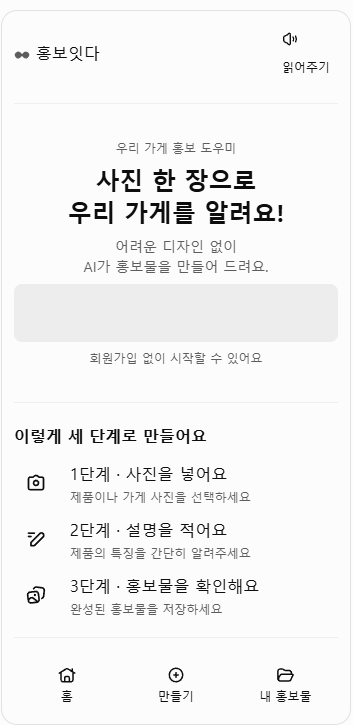
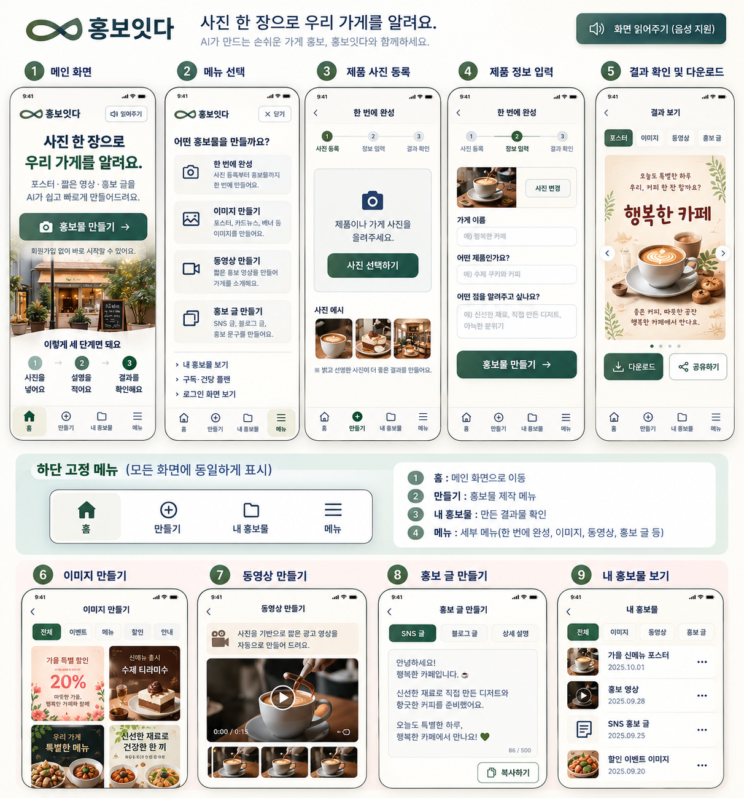

# Professor Feedback — Mobile UI/UX and Persistent Bottom Navigation

## Record and scope

- Project: 홍보잇다 (Hongboitda)
- Reviewer: Professor Oh So-jin (오소진)
- Recorded: October 12, 2026, Asia/Seoul
- Sources: the professor's message supplied by the user and two attached reference images.
- Status: first feedback archive and reference analysis; implementation and final screen approval are pending.

The professor's written requests are distinguished below from observations in the reference images and proposed implementation criteria. This document records feedback; it does not certify that the existing application meets it. Image details are design references, not independent authorization to implement every illustrated feature.

## 1. Professor's message — English translation

> Hello, this is Oh So-jin.
>
> Previously, we discussed a quick-access menu that would remain fixed at the bottom of the screen. I am disappointed that this has not been reflected.
>
> Please finalize the screen layout so that the service can be developed for mobile.
>
> This is the screen arrangement I have in mind.

The message does not specify a technical cause for the missing navigation or identify a particular source-code defect.

## 2. Explicit requests

1. Reflect the previously discussed persistent bottom quick-access menu.
2. Finalize a screen arrangement suitable for mobile implementation.
3. Use the supplied screen arrangements as references when reviewing that layout.

The central correction is persistent access to navigation throughout the mobile experience. A menu visible only near the end of a page would not satisfy the stated intention.

## 3. Preserved reference images

The original PNG image data is preserved alongside this document under the current local filenames below. The images have not been resized, cropped, annotated, or recompressed.

| Stored file | Original source filename | Reference |
| --- | --- | --- |
| `10.12.a.png` | `다운로드.png` | Simple mobile home wireframe |
| `10.12.b.png` | `다운로드 (1).png` | Detailed mobile screen sequence and bottom-navigation specification |

### Reference 1 — Simple mobile home wireframe



Observed structure, from top to bottom:

- A compact header with the service name on the left and a speaker/read-aloud control on the right.
- A centered value proposition: promote a local store with one photo, without needing design skills.
- A large gray rounded placeholder beneath the introduction. Its intended content or action is not labeled in this image.
- Reassurance that the user can start without registering.
- A three-step introduction: add a photo, write a description, and review/save the promotional materials.
- Bottom navigation with icons and text labels for Home, Create, and My Promotional Materials.

This image establishes a simple mobile information hierarchy. A static image cannot demonstrate scrolling behavior; the requirement that the bottom menu remain fixed comes from the professor's message.

### Reference 2 — Detailed mobile screen arrangement



The board contains nine numbered screens, a read-aloud feature reference, and a prominent specification stating that the same bottom menu appears on all screens.

| No. | Screen | Observed content and actions |
| --- | --- | --- |
| 1 | Home | Brand header and read-aloud control; a clear promotional message; a primary Create action; no-registration reassurance; a store illustration; a three-step guide; persistent bottom navigation. |
| 2 | Creation menu | Four options: complete everything in one flow, create an image, create a video, or create promotional copy. Secondary links include saved materials, plans, and login. A close control is shown. |
| 3 | Photo registration | A back control, flow title, and three-step progress indicator; a large photo-selection area and button; example photos and a short photo-quality tip. |
| 4 | Product/store information | The same progress indicator, with information entry active; a photo preview with Change Photo; fields for store name, product description, and what to emphasize; a primary Create action. |
| 5 | Results and download | Result-type tabs for poster, image, video, and promotional copy; a large poster preview; previous/next controls and pagination dots; Download and Share actions. |
| 6 | Image creation | Category tabs such as All, Event, Menu, Discount, and Notice; a grid of image examples. The image alone does not establish whether these are templates, generated results, or a selection gallery. |
| 7 | Video creation | A short explanation of photo-based video creation; a prominent video preview with playback controls; thumbnails underneath. The displayed duration is illustrative, not a confirmed provider requirement. |
| 8 | Promotional-copy creation | Tabs for social posts, blog posts, and detailed descriptions; a readable text area with a character counter; a Copy action. |
| 9 | My Promotional Materials | Filters for All, Images, Videos, and Copy; a list with thumbnails/type icons, titles, dates, and per-item overflow menus. |

The detailed reference uses a warm background, dark green primary actions and active states, dark text, rounded cards, and icon-plus-text controls. It illustrates a consistent visual language rather than a definitive asset, font, or color specification.

## 4. Bottom-navigation behavior shown in the detailed reference

| Label | Intended destination |
| --- | --- |
| Home (홈) | Main/home screen |
| Create (만들기) | Promotional-material creation menu |
| My Promotional Materials (내 홍보물) | Previously created materials |
| Menu (메뉴) | Detailed service navigation, including creation types |

The detailed reference explicitly emphasizes that this bottom menu should be displayed consistently on every screen. The active destination is visually highlighted. Icons are accompanied by readable labels.

Creation progress and global navigation serve different purposes: the three-step indicator describes Photo → Information → Results, while the bottom menu provides access to major destinations.

## 5. Differences and decisions to resolve

| Item | Difference or uncertainty | Proposed direction for the next review |
| --- | --- | --- |
| Number of navigation items | Reference 1 has three destinations; Reference 2 has four, adding Menu. | Use the detailed four-item arrangement as the working proposal, subject to confirmation. The three-item version is not discarded from this archive. |
| Home placeholder | The first image shows an unlabeled gray block; the second shows a clear Create button and a store illustration. | Confirm whether the block represents a primary action, media, or another element. |
| Store vs. product terminology | The detailed form uses store-oriented labels, while the flow title and photo step also refer to products. | Agree on labels that support both store owners and individual products. |
| Image categories and galleries | Several category tabs and image examples are shown without interaction details. | Confirm their role before expanding the feature scope. |
| Saved materials | The reference shows a dated history list. | Decide whether the first version uses temporary browser history or persistent storage, and communicate that clearly. |
| Share, login, and plans | These features appear in the visual reference but are not individually requested in the written message. | Confirm whether they belong in the current review scope. |

Illustrative sample copy, dates, discounts, images, and video durations should not be treated as approved production content. The exact service name remains 홍보잇다.

## 6. Proposed criteria for a later implementation review

These are practical criteria derived from the feedback and mobile reference, not additional verbatim requests from the professor:

- Keep the bottom navigation visible while the page content scrolls across home, creation, results, and saved-material screens.
- Reserve sufficient space above the navigation so it does not cover fields, result controls, or primary actions; accommodate mobile safe areas.
- Define navigation behavior while the on-screen keyboard is open, including access to the focused field and form submission.
- Use the same destinations, order, labels, and active-state treatment throughout the mobile experience.
- Keep creation controls distinct from global navigation and show Photo → Information → Results progress where relevant.
- Make the primary action apparent on each screen and use clear Korean labels, readable text, and comfortable touch targets.
- Preserve entered information when users move between creation steps, or provide a clear warning before discarding it.
- Confirm that a preview represents the same content that will be downloaded or shared.
- Keep photo replacement, loading, failure, retry, empty-history, and unsupported-action states understandable.
- Clearly identify sample outputs during the UI/UX review phase, before real AI generation is connected.

## 7. Archive contents

```text
ad_prototype/feedback/
├── 2026-10-12-professor-uiux-feedback.md
├── 10.12.a.png
└── 10.12.b.png
```

Next step: confirm the mobile screen arrangement and bottom-navigation choices, then implement and visually review them. This first archive preserves the professor's feedback and source references for that work.
